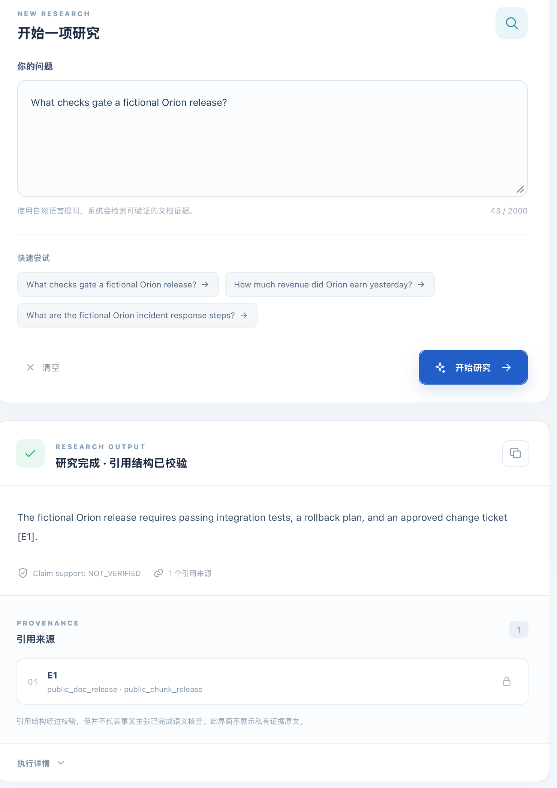
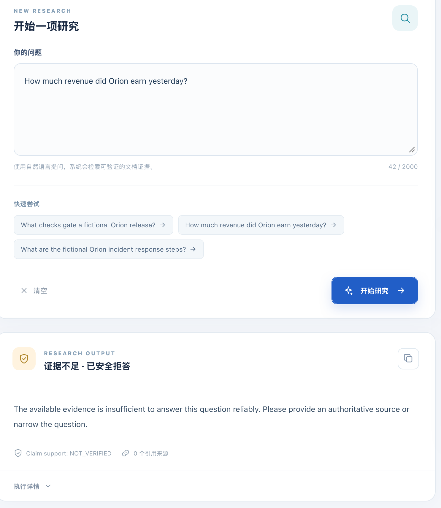
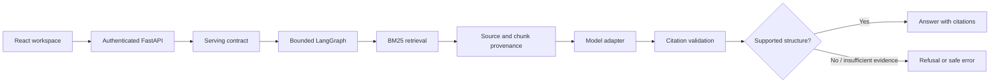

# Evidence-grounded Research Agent

**A full-stack RAG research application that makes evidence traceable, bounds LLM workflows, and refuses unsupported questions.**

Built with **Python 3.13 · BM25 · LangGraph · FastAPI · React/TypeScript**. The public demo runs on your laptop with original fictional documents and a deterministic model substitute—**no provider account, API key, or cloud deployment required**.

[**Run the demo**](#try-it-locally) · [**Architecture**](docs/ARCHITECTURE.md) · [**Evaluation and failures**](docs/EVALUATION.md) · [**5-minute walkthrough**](docs/DEMO-GUIDE.md)

## Results at a glance

| 14 / 16 | 4 / 4 | 8 / 8 vs. 8 / 8 |
| :--- | :--- | :--- |
| **Correct outcomes** in a first-exposure, same-corpus 16-question internal evaluation | **Appropriate abstentions** on four questions without enough evidence | **Correct outcomes** for both the baseline and LangGraph workflows in an earlier eight-question paired test |

These are **historical, owner-reviewed internal studies using real Groq calls and a private document corpus**—not scores measured on the fictional public fixture. The 16-question evaluation also had **two answerable questions fail because BM25 top-5 retrieval missed sufficient evidence**. The evaluation is small and was reviewed with AI assistance; it is not an externally blinded benchmark or an accuracy guarantee. [Read the protocol, failure analysis and limitations](docs/EVALUATION.md).

## See it in action — actual local demo screenshots

These screenshots were captured from the **working React application** running the original **fictional Orion** fixture and a **deterministic fake LLM**. They are **not** screenshots of the private Groq evaluation or proof of semantic factual correctness. Citation identifiers are structurally checked; the UI explicitly reports `Claim support: NOT_VERIFIED`.

| Evidence-linked answer | Safe refusal |
| :---: | :---: |
| [](docs/assets/demo-cited-answer.png) | [](docs/assets/demo-safe-refusal.png) |
| Fictional release checks; synthetic citation `E1` (`public_doc_release` / `public_chunk_release`). | Unsupported revenue question; `INSUFFICIENT_EVIDENCE`, **zero citations**. |

Select either screenshot to view it at full resolution. [View the full workspace](docs/assets/demo-workspace.png) · [Follow the five-minute demo walkthrough](docs/DEMO-GUIDE.md).

## What the application actually does

- **Evidence provenance:** keeps source/chunk identities and verifies that returned citation IDs refer to authorized retrieved evidence.
- **Bounded orchestration:** LangGraph coordinates retrieval, model response, citation checking, bounded repair and explicit termination/failure states.
- **Fail-closed answers:** abstains when evidence is insufficient; malformed or unauthorized citations cannot quietly become supported answers.
- **Safe serving and UI:** FastAPI request limits, local Bearer authentication, CORS restrictions, redacted diagnostics and a React workspace that distinguishes answers from refusals.
- **Reproducible engineering:** locked dependencies, static analysis, security checks, real HTTP integration tests and an independently runnable synthetic demo.



**Scope distinction:** the public demo uses **real BM25, LangGraph, provenance, validation, FastAPI and React** but replaces the LLM with a **deterministic fake** and the source corpus with original **Orion** documents. The internal experiments used real Dubbo documents and Groq; neither those documents nor the Gold data or raw model responses are distributed here. Citation structure is checked; semantic entailment is **not** automatically proven (`claim_support=NOT_VERIFIED`).

## Try it locally

**Requirements:** Python 3.13, [uv](https://docs.astral.sh/uv/), Node.js 22+, npm; available loopback ports 8000 and 5173.

**1. Run the automated checks and HTTP demo:**

```bash
uv sync --locked --dev
bash scripts/verify-public.sh
uv run python tools/public_demo_smoke.py
(cd web && npm ci && npm run check)
```

**2. Start the API** (Terminal 1, from the repository root):

```bash
export P2_API_KEY="$(python -c 'import secrets; print(secrets.token_urlsafe(32))')"
export P2_API_CORS_ORIGINS='http://127.0.0.1:5173'
export P2_API_MIN_INTERVAL_SECONDS=0
uv run python tools/public_demo_api.py --demo-only --port 8000
```

**3. Start the UI** (Terminal 2):

```bash
cd web
npm ci
npm run dev -- --host 127.0.0.1
```

Open **http://127.0.0.1:5173** and paste the **local API key** created in Terminal 1. The browser keeps that key in memory only. No real LLM provider is called.

### Two questions to demonstrate the safety boundary

| Ask the fictional Orion demo | Expected behavior |
| --- | --- |
| `What checks gate a fictional Orion release?` | Returns an answer citing synthetic evidence `E1` and a document/chunk ID; claim support remains `NOT_VERIFIED` |
| `How much revenue did Orion earn yesterday?` | Returns `INSUFFICIENT_EVIDENCE` with no citations, instead of inventing a number |

A real local HTTP run produced this **synthetic** answer: “The fictional Orion release requires passing integration tests, a rollback plan, and an approved change ticket [E1].” The returned citation identifies `public_doc_release` / `public_chunk_release`; it is **not** a claim about any real organization.

See the [step-by-step walkthrough](docs/DEMO-GUIDE.md) for the full demo and commands.

## Engineering decisions worth discussing

| Decision | Rationale and observed trade-off |
| --- | --- |
| **BM25 as the default** | Five approaches were evaluated internally (BM25, dense exact cosine, hybrid RRF, pgvector, Qdrant). BM25 remained the small-pilot baseline; the first-exposure misses show why retrieval quality remains the main bottleneck. |
| **Bounded LangGraph rather than an unbounded agent** | Explicit state and controlled failure/repair are engineering benefits. In the earlier eight-case study LangGraph had **no observed correctness improvement** and used 9 model calls instead of 8, with higher mean answer latency. |
| **Separate evidence identity from truth** | A valid citation ID is not proof that the cited text logically entails a claim. The system explicitly exposes this limitation. |
| **Private corpus, public fixture** | Source licensing and research data integrity are kept separate from public code reproducibility. The original 24-document / 409-chunk research dataset is not redistributed. |

## Project map

| Path | What to inspect |
| --- | --- |
| `src/p2_research/application/` | Retrieval, grounded response handling and evidence contracts |
| `src/p2_research/infrastructure/workflows/` | Bounded LangGraph execution and deadline behavior |
| `src/p2_research/infrastructure/serving/` | FastAPI adapter, serving contract and observability |
| `web/src/` | TypeScript/React research interface |
| `public_demo/` and `tools/public_demo_*.py` | Synthetic corpus and real integration entry points |
| `tests/public/` and `.github/workflows/public-ci.yml` | Public reproducibility and CI gates |

More: [Architecture & trust boundaries](docs/ARCHITECTURE.md) · [Evidence-bound results](docs/EVALUATION.md) · [Security & non-goals](docs/SECURITY.md) · [Dependency license review](docs/THIRD-PARTY-LICENSE-REVIEW.md).

## Boundaries and licensing

This is a **local demonstrator, not a hosted production service**. It does not establish semantic truth, cross-domain accuracy, multi-tenant safety or production cloud readiness. Pacing and telemetry are process-local; container operations were tested separately on the owner's machine, not certified for public Internet deployment. [Security limitations](docs/SECURITY.md).

Original project code and fictional demo content: **Apache-2.0**, `Copyright 2026 Pan Zheng` ([LICENSE](LICENSE), [NOTICE](NOTICE)). Dependencies retain their own licenses. The repository deliberately excludes third-party Dubbo text, images, private Gold/evaluation captures, secrets and the original private Git history. The SHA-256 [public file manifest](PUBLIC-CURATION-MANIFEST.json) is a source-integrity inventory, **not** a security or legal guarantee.
