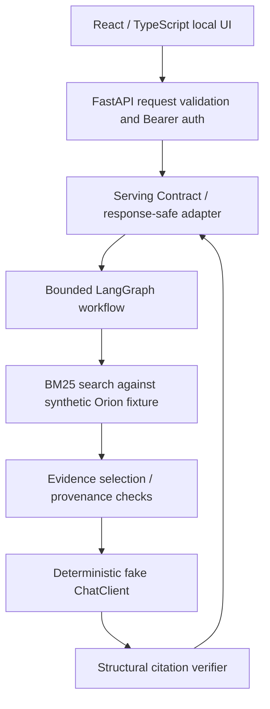

# Public Demo — Evidence-grounded Research Agent Architecture

This diagram documents what **actually executes** in the standalone fictional Orion demo. The same domain/application and infrastructure layers support the private research project, but the real corpus and historical Gold are **not** shipped.

**Boundary:** Synthetic fixture → real chunk/provenance checks → BM25 → bounded workflow → fake LLM → citation checker. The deterministic model is **not** evidence of real LLM answer quality. The citation checker validates known evidence identifiers and citation structure, not logical entailment between a claim and a cited passage.

### Component boundaries

| Layer | Responsibilities | Intentional exclusion |
| --- | --- | --- |
| Domain/Application | Evidence contracts, retrieval and grounding rules | Browser framework details |
| Infrastructure | BM25, bounded LangGraph, FastAPI adapter, telemetry | Model training |
| React client | Request state, answer/refusal, safe citations | Provider API key storage |
| Public fixture | Fictional Orion documents and byte-accurate checksums | Real Dubbo corpus or private Gold |

The API's pacing and observability are in-process and single-worker. This project has not been evaluated as a multi-tenant, multi-worker production service. Container deployment is a separate internal exercise; this public package demonstrates the Python/React application locally and does not publish raw internal data or Docker supply-chain certificates.
