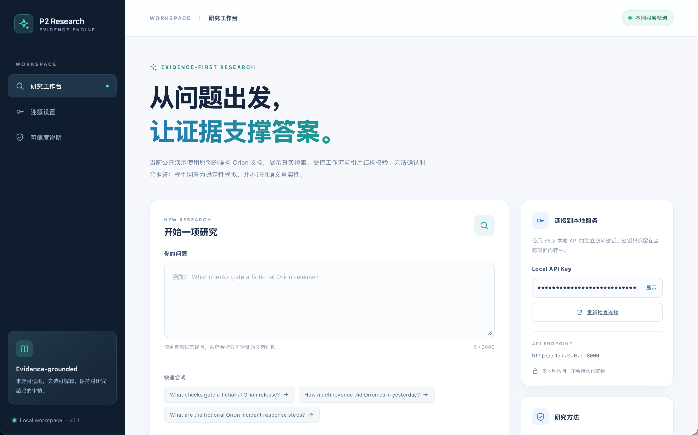

# Five-minute live walkthrough — fictional Orion demo

**Audience:** AI engineer, backend engineer or ML platform reviewer. The demo illustrates a **working application**, not real-model benchmark accuracy. The corpus and model output are explicitly synthetic; all retrieval/graph/HTTP/UI code follows the public application path.

## 1. Start with the observable engineering outcome (45 seconds)

Show the [README results](../README.md#results-at-a-glance): in a historical internal first-exposure 16-case study, 14/16 answers/refusals passed, including 4/4 expected abstentions. **Two answerable items failed because BM25 Top-5 missed sufficient evidence.** The public fixture does not replay that study. The eight-question Stage 3/Stage 5 comparison saw no accuracy uplift from LangGraph.

## Visual walkthrough (real local UI; fictional data)

The following **real browser captures** were taken from the public Orion demo. They show the deterministic model substitute, not real Groq results. The UI's `Claim support: NOT_VERIFIED` correctly limits the claim made by structural citation validation.

- [Research workspace — initial state](assets/demo-workspace.png)
- [Evidence-linked answer — question, E1 provenance, and result](assets/demo-cited-answer.png)
- [Safe refusal — insufficient evidence and zero citations](assets/demo-safe-refusal.png)



## 2. Run the public demo (about 2 minutes)

Requirements: Python 3.13, `uv`, Node.js 22+, npm, and loopback ports 8000 and 5173. The repository ships **no original third-party corpus**.

From the repository root, verify the source and exercise the HTTP path:

```bash
python tools/s93_release_gate.py --root . --enforce
uv sync --locked --dev
bash scripts/verify-public.sh
uv run python tools/public_demo_smoke.py
(cd web && npm ci && npm run check)
```

Terminal 1, from the repository root:

```bash
export P2_API_KEY="$(python -c 'import secrets; print(secrets.token_urlsafe(32))')"
export P2_API_CORS_ORIGINS='http://127.0.0.1:5173'
export P2_API_MIN_INTERVAL_SECONDS=0
uv run python tools/public_demo_api.py --demo-only --port 8000
```

Terminal 2:

```bash
cd web
npm ci
npm run dev -- --host 127.0.0.1
```

Visit **http://127.0.0.1:5173**, paste the local key generated in Terminal 1 and check the readiness indicator.

### Case A — Evidence-linked answer

Ask: `What checks gate a fictional Orion release?`

Expected: an `ANSWERED` response about fictional integration tests, a rollback plan and an approved change ticket, with synthetic citation `E1`, `public_doc_release` and `public_chunk_release`. The citation is structurally verified; **`claim_support=NOT_VERIFIED` does not assert semantic entailment**.

### Case B — Refusal rather than invention

Ask: `How much revenue did Orion earn yesterday?`

Expected: `INSUFFICIENT_EVIDENCE`, with **no citation**. The fictional documents contain no such reliable revenue information. The answer comes from a deterministic fake model; it is not evidence of real-provider accuracy.

## 3. Show the architecture and trade-off (90 seconds)

Follow the [architecture diagram](ARCHITECTURE.md) from React through the authenticated FastAPI serving boundary into the bounded LangGraph and BM25 retrieval. Explain why the public package deliberately separates synthetic source loading from the internally SHA-256-locked 409-chunk corpus.

Discuss **one failure rather than hiding it**: two Stage 7 answerable cases were correct to refuse rather than hallucinate, but both **failed correctness** because retrieval omitted adequate evidence. This motivates retrieval diagnostics and better recall, not a larger prompt alone.

## 4. Close with the evidence boundary (30 seconds)

This demo proves integration, authorization, source-ID checks and explicit refusal in a local environment. It **does not** certify semantic truth, public Internet deployment, multi-replica reliability, or the historical Groq study. The browser key is local and in-memory, and no provider credit is required.

For exact internal study metrics and caveats, see [EVALUATION.md](EVALUATION.md). For security and trust boundaries, see [SECURITY.md](SECURITY.md).
